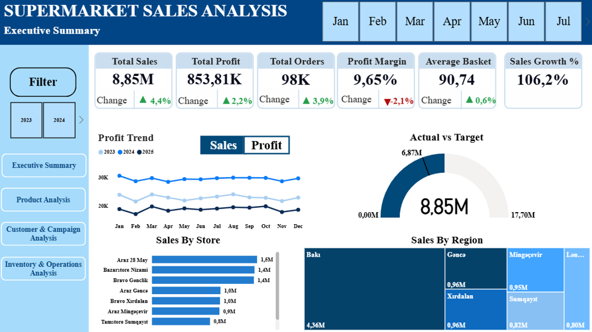
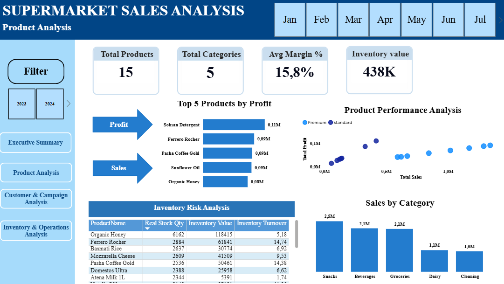
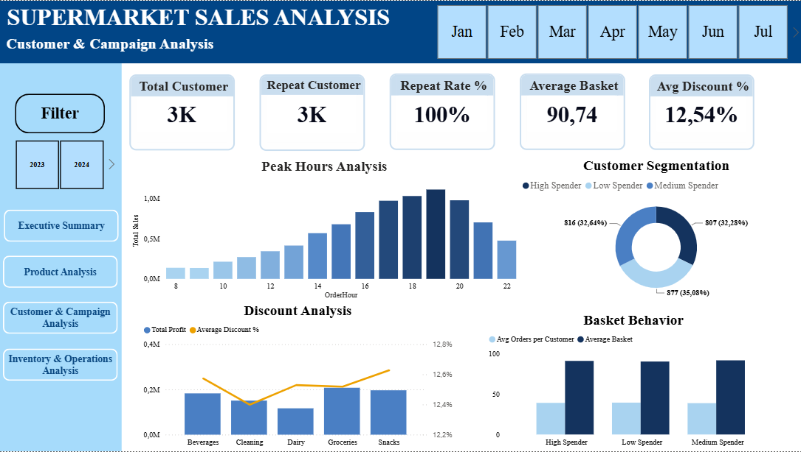
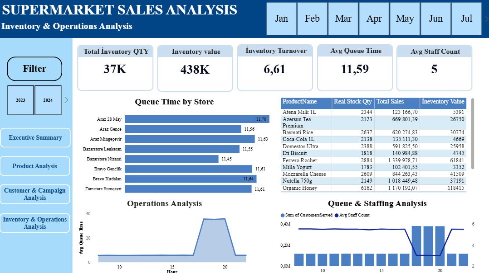

# Supermarket Sales Analysis | Power BI Dashboard

Supermarket satışlarının, məhsulların, müştərilərin və əməliyyat göstəricilərinin təhlili üçün hazırlanmış interaktiv Power BI dashboardu.

## Layihənin məqsədi

Supermarket şəbəkəsinin fəaliyyətini bir yerdə izləmək və aşağıdakı suallara cavab tapmaq:

- Satış və mənfəət zamanla necə dəyişir?
- Hansı məhsullar və kateqoriyalar ən çox gəlir gətirir?
- Müştərilər necə seqmentlərə bölünür və təkrar alış nisbəti nədir?
- Endirimlər mənfəətə necə təsir edir?
- Anbar qalığı, növbə vaxtı və işçi sayı əməliyyat səmərəliliyinə necə təsir edir?

## Dashboard səhifələri

### 1. Executive Summary
Ümumi icmal səhifəsi. Əsas KPI-lar: **Total Sales, Total Profit, Total Orders, Profit Margin, Average Basket, Sales Growth %**. Satış və mənfəət trendi, hədəf ilə faktiki satışın müqayisəsi (Actual vs Target), mağaza və region üzrə satışlar.

### 2. Product Analysis
Məhsul təhlili: Top 5 məhsul (satış və mənfəət üzrə), kateqoriya üzrə satışlar, məhsulların performans təhlili (scatter chart), inventar risk cədvəli.

### 3. Customer & Campaign Analysis
Müştəri təhlili: ümumi və təkrar müştəri sayı, Repeat Rate %, müştəri seqmentasiyası, ən aktiv saatlar (Peak Hours), endirim təhlili, səbət davranışı.

### 4. Inventory & Operations Analysis
Əməliyyat təhlili: ümumi inventar miqdarı və dəyəri, inventar dövriyyəsi (Inventory Turnover), orta işçi sayı, orta növbə vaxtı, mağazalar üzrə növbə vaxtı və saatlıq işçi/müştəri xidməti təhlili.

### Əlavə səhifələr
- **Drill Through - Product Details**: ətraflı məlumat üçün drill-through səhifəsi
- **Tooltip - Category Performance** və **Tooltip - Sales by City**: hover zamanı görünən tooltip səhifələri

## Screenshot-lar

## Data modeli

Data modeli fakt və ölçü cədvəllərindən ibarətdir.

| Cədvəl | Növ | Təsvir |
|--------|-----|--------|
| FactSales | Fakt | Satış əməliyyatları (miqdar, sifariş saatı və s.) |
| FactOperations | Fakt | Saatlıq əməliyyat göstəriciləri (xidmət göstərilən müştəri sayı və s.) |
| FactInventory | Fakt | Anbar qalığı və inventar məlumatları |
| DimDate | Ölçü | Tarix (il, ay) |
| DimStore | Ölçü | Mağaza (ad, şəhər) |
| DimProduct | Ölçü | Məhsul (ad, kateqoriya, seqment) |
| DimCustomer | Ölçü | Müştəri (seqment) |

Bütün DAX hesablamaları ayrıca **Ölçülər** cədvəlində saxlanılır (Total Sales, Total Profit, Profit Margin %, Average Basket, Repeat Customer Rate %, Inventory Turnover, Avg Queue Time və s.).

## İstifadə olunan texnologiyalar

- Power BI Desktop
- DAX
- Data modelləşdirmə

## İnteraktiv funksiyalar

- Slicer-lər: İl, Ay, Müştəri seqmenti, Kateqoriya, Mağaza
- Səhifələr arası naviqasiya düymələri
- Drill-through və tooltip səhifələri

## Necə açmaq olar

1. Bu repozitoriyanı yükləyin (**Code → Download ZIP**) və ya klonlayın
2. `.pbix` faylını **Power BI Desktop** ilə açın (Power BI Desktop pulsuz yüklənə bilər: [powerbi.microsoft.com](https://powerbi.microsoft.com/desktop/))

## Müəllif

**Aytac Əliyeva**
GitHub: [@Aytac04176](https://github.com/Aytac04176)
